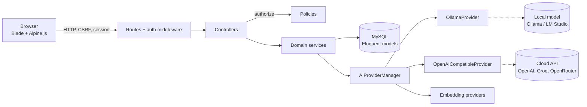
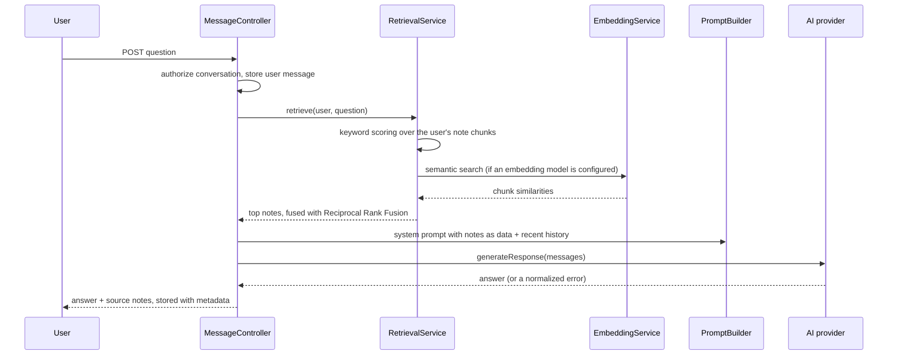
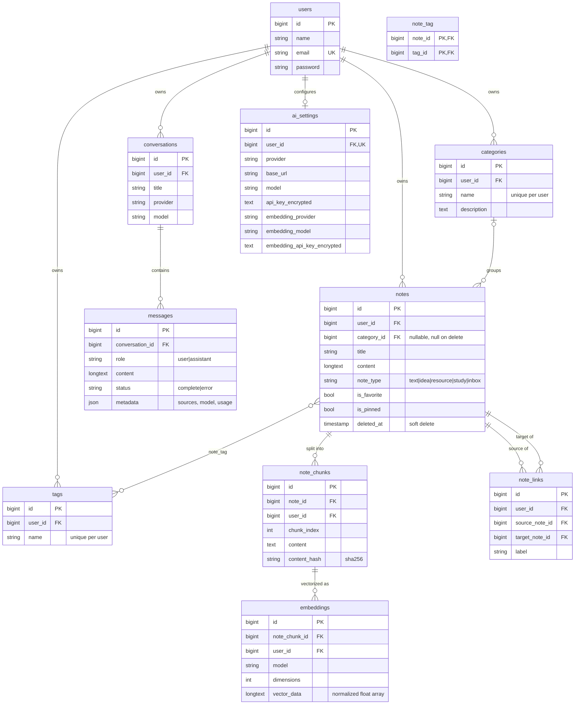

# Second Brain: Architecture and Database Design

## 1. System overview

Controllers validate and authorize, then delegate. They never call a vendor API directly:
all AI traffic goes through `AIProviderManager`, which resolves the user's configured adapter.

| Layer | Location | Responsibility |
|---|---|---|
| Views | `resources/views` | Blade templates, Alpine.js for small interactions, vanilla canvas for the graph |
| Routing | `routes/web.php` | URL map, every private route behind `auth` |
| Controllers | `app/Http/Controllers` | Request validation, authorization, response |
| Form requests / Policies | `app/Http/Requests`, `app/Policies` | Input rules, per-record ownership checks |
| Knowledge services | `app/Services/Knowledge` | Chunking, embeddings, hybrid retrieval, prompts, summaries, related notes, graph |
| AI adapters | `app/Services/AI` | Provider interface, Ollama + OpenAI-compatible adapters, error normalization |

## 2. Brain AI request flow (retrieval-augmented generation)

Key decisions:
- **Hybrid retrieval.** Keyword search is exact and explainable; embeddings catch synonyms ("automobile" finds "car"). Reciprocal Rank Fusion merges the two rankings without comparing incompatible score scales.
- **Thresholds calibrated on real data.** Embedding models give unrelated text a baseline similarity of about 0.3 to 0.45 (nomic-embed-text). Results need an absolute floor *and* must be close to the best match (relative margin). Values are configurable in `.env`.
- **Incremental indexing.** Notes are split into overlapping chunks. Only chunks whose SHA-256 hash changed are re-embedded, so editing one paragraph does not re-embed the whole note.
- **Graceful degradation.** If the embedding endpoint is down, search falls back to keyword-only; if the chat model is down, the error is shown in the chat and all note features keep working.
- **Prompt-injection hygiene.** Notes are wrapped in `<note>` tags and the system prompt instructs the model to treat them as data, not instructions. AI output is never saved without the user reviewing it in the note form.

## 3. Entity relationship diagram

Integrity rules: all ownership foreign keys cascade on user deletion; deleting a category sets `notes.category_id` to null; deleting a note cascades to its chunks, embeddings, tag pivots and links; `(note_id, tag_id)` and `(source_note_id, target_note_id)` are unique; a note cannot link to itself (validated in the controller). MySQL additionally gets a FULLTEXT index on `notes(title, content)`.

## 4. Security controls

| Threat | Control | Where |
|---|---|---|
| User A reads/edits User B's data | Policies on every record route, all queries scoped by `user_id`, `exists` rules scoped to the user | `app/Policies`, controllers, `NoteRequest` |
| Leaking other users' notes through AI | Retrieval, embeddings and graph queries filter by `user_id` | `RetrievalService`, `EmbeddingService`, `RelatedNotesService` |
| API key exposure | `encrypted` cast, `$hidden`, never rendered back (placeholder only) | `AISetting` model, settings view |
| SQL injection | Eloquent / query builder parameter binding | everywhere |
| XSS | Blade `{{ }}` escaping; chat markdown renderer escapes before formatting | views, `brain/show.blade.php` |
| CSRF | Laravel CSRF tokens on all forms and the chat fetch call | layouts |
| Abuse of AI endpoint | Rate limits: 20 chat messages/min, 3 re-index runs/min | `routes/web.php` |
| SSRF via AI endpoint setting | HTTPS required for remote hosts, private/reserved/metadata IPs blocked (DNS-checked), redirects disabled, local endpoints switchable off | `app/Rules/SafeAiEndpoint.php` |
| Untrusted AI output | Save-to-brain opens the note form for review; summaries are labelled as suggestions | `MessageController@saveAsNote` |

## 5. Route map

| Method | URI | Purpose |
|---|---|---|
| GET | /dashboard | Stats, quick capture, recent and pinned notes |
| GET/POST | /notes, /notes/create | List with search/filters, create |
| GET/PUT/DELETE | /notes/{note}, /notes/{note}/edit | View, update, move to trash |
| POST | /notes/{id}/restore, DELETE /notes/{id}/force | Restore from trash, delete permanently |
| POST | /notes/{note}/toggle/{flag} | Favorite / pin |
| POST | /notes/{note}/links | Link two notes |
| POST | /notes/{note}/summarize | AI summary |
| POST | /capture | Quick capture to inbox |
| GET/POST/PUT/DELETE | /categories... | Manage categories |
| GET | /graph | Knowledge graph |
| GET/POST/DELETE | /brain, /brain/conversations/... | Brain AI sessions |
| POST | /brain/conversations/{c}/messages | Ask a question (JSON or form) |
| POST | /brain/messages/{m}/save-as-note | Propose a note from an AI answer (preview, not saved) |
| POST | /notes/{note}/summary-as-note | Propose a note from an AI summary |
| GET/POST | /capture, /capture/{note}/convert | Inbox page, convert item to note |
| GET/POST/DELETE | /tags | Manage tags |
| GET/PUT | /settings/ai | AI configuration |
| POST | /settings/ai/test, /test-embeddings, /reindex | Connectivity checks, rebuild vectors |
